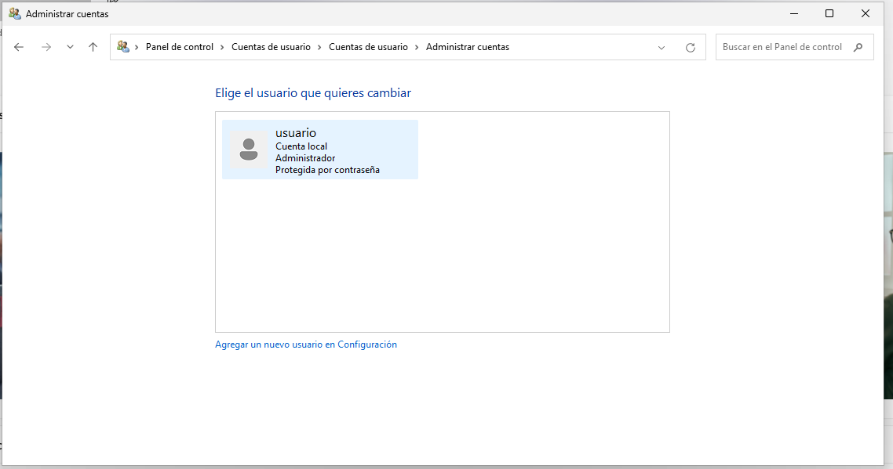

# Gestión de usuarios

En Windows, cada usuario tiene su propio espacio y configuración. 

- Una **cuenta local** funciona en ese ordenador y no necesita una cuenta de Microsoft.
- Una cuenta **estándar** sirve para las tareas habituales y puede ser local o estar asociada a una cuenta de Microsoft.
- Una cuenta **administradora** también puede instalar programas y cambiar opciones importantes del sistema.

Por seguridad, conviene usar una cuenta estándar para el trabajo diario y reservar los permisos de administrador para cuando hagan falta.

> **Antes de empezar:** realiza las actividades en tu máquina virtual de Windows. Cuando domines las tareas, las puedes intentar en otros ordenadores, como por ejemplo, el de casa.

!!! warning "Mira este vídeo"
    [https\://www\.youtube.com/watch?v=nc7VNHuhc6w\&t=3s](https://www.youtube.com/watch?v=nc7VNHuhc6w) 

## Tipos de usuarios

### Tarea 1. Identificar las cuentas del equipo

1. Abre **Inicio > Configuración > Cuentas > Otros usuarios**.
2. Observa qué cuentas aparecen, sin modificar ninguna.
3. Haz una captura de pantalla donde se muestren las cuentas de tu instalación y guárdala como `Tarea1.jpg`.

## Crear usuarios

### Tarea 2. Crear tres cuentas locales

1. En **Configuración > Cuentas > Otros usuarios**, selecciona **Agregar cuenta**.
2. Elige **No tengo la información de inicio de sesión de esta persona** y después **Agregar un usuario sin cuenta Microsoft**.
3. Crea una cuenta llamada `mamá` y establece una contraseña de prueba. No uses una contraseña personal ni la compartas. Esta cuenta tiene que ser de tipo **Usuario estándar**.
4. Repite el proceso para crear otra cuenta llamada `administrador2`. Esta cuenta tiene que ser de tipo **Usuario administrador**.
5. Repite el proceso para crear una tercera cuenta llamada `prueba4eso`. Esta cuenta debe ser de tipo **Usuario estándar**.
6. Comprueba que las tres cuentas aparecen en la lista. No cierres la sesión si no sabes cómo volver a entrar en tu cuenta habitual.
7. Haz una captura de pantalla donde se muestren las tres cuentas y guárdala como `Tarea2.jpg`.

## Modificar usuarios

### Tarea 3. Cambiar el tipo de cuenta

1. Cambia el tipo de la cuenta `prueba4eso` de **Usuario estándar** a **Administrador**.
2. Comprueba que `mamá` es estándar y que `administrador2` y `prueba4eso` son administradoras.
3. Haz una captura de pantalla donde se vean los tipos de las tres cuentas y guárdala como `Tarea3.jpg`.

### Cambiar contraseña

### Cambiar contraseñas según el tipo de usuario

#### Tarea 4. Desde una cuenta estándar

1. Inicia sesión con `mamá`.
2. Abre **Configuración > Cuentas > Otros usuarios** y selecciona `administrador2`. Comprueba que desde esta cuenta estándar no aparece ninguna opción para cambiar la contraseña de otro usuario.
3. En **Configuración**, entra en **Cuentas > Opciones de inicio de sesión > Contraseña > Cambiar**.
4. Cambia la contraseña de `mamá`. No uses una contraseña personal ni incluyas contraseñas en la captura. Cierra la sesión e inicia de nuevo con la contraseña nueva.
5. Haz una captura de pantalla que muestre que has iniciado sesión con `mamá` y guárdala como `Tarea4.jpg`.

#### Tarea 5. Desde una cuenta administradora

1. Cierra la sesión de `mamá` e inicia sesión con `administrador2`.
2. Para cambiar la contraseña propia, abre **Configuración > Cuentas > Opciones de inicio de sesión > Contraseña > Cambiar**. Establece una contraseña de prueba; no uses una contraseña personal.
3. Para cambiar la contraseña de otro usuario, abre el menú **Inicio**, busca y abre **Panel de control**.
4. Entra en **Cuentas de usuario > Cuentas de usuario > Administrar otra cuenta** y selecciona `prueba4eso`.
5. Elige **Cambiar la contraseña** y establece una contraseña de prueba. No incluyas contraseñas en la captura.
6. Comprueba que se ha cambiado la contraseña de `prueba4eso`. Así puedes ver que una cuenta administradora puede cambiar la contraseña de otra cuenta local mediante la interfaz gráfica.
7. Haz una captura de pantalla del resultado, sin mostrar ninguna contraseña, y guárdala como `Tarea5.jpg`.

## Borrar usuarios

### Tarea 6. Eliminar las cuentas de prueba

1. Vuelve a tu cuenta habitual y abre **Configuración > Cuentas > Otros usuarios**.
2. Elimina las cuentas `mamá`, `administrador2` y `prueba4eso`. Lee el aviso antes de confirmar: al eliminar una cuenta también pueden borrarse sus datos del equipo.
3. Comprueba que las tres cuentas de prueba ya no aparecen en la lista.
4. Haz una captura de pantalla donde se vea que ya no aparecen y guárdala como `Tarea6.jpg`.
