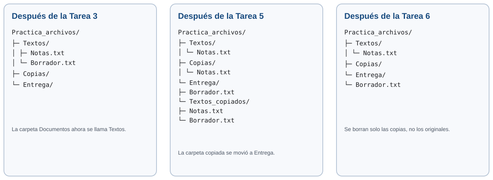

# Directorios y archivos

En esta práctica aprenderás a organizar carpetas y archivos en Windows 11 con el **Explorador de archivos**. 
Guarda el trabajo en la carpeta **Documentos** de tu máquina virtual. Después de cada tarea, haz una captura que muestre el resultado en el Explorador de archivos y guárdala con el nombre indicado: `Tarea X.jpg`.

## Tarea 1. Crear directorios

1. Abre el **Explorador de archivos** y entra en **Documentos**.
2. Haz clic con el botón derecho en un espacio vacío y selecciona **Nuevo > Carpeta**.
3. Crea una carpeta llamada `Practica_archivos`.
4. Entra en ella y crea tres carpetas: `Documentos`, `Copias` y `Entrega`.
5. Haz una captura donde se vean las tres carpetas dentro de `Practica_archivos`. Guárdala como `Tarea 1.jpg`.

## Tarea 2. Crear ficheros

1. Entra en `Practica_archivos/Documentos`.
2. Haz clic con el botón derecho en un espacio vacío y selecciona **Nuevo > Documento de texto**.
3. Crea dos archivos llamados `Notas.txt` e `Ideas.txt`. Si Windows no muestra las extensiones, activa **Ver > Mostrar > Extensiones de nombre de archivo** en el Explorador.
4. Abre cada archivo con el Bloc de notas, escribe una frase breve y guarda los cambios.
5. Haz una captura donde se vean los dos archivos dentro de la carpeta `Documentos`. Guárdala como `Tarea 2.jpg`.

## Tarea 3. Cambiar el nombre a directorios y ficheros

1. Dentro de `Practica_archivos/Documentos`, cambia el nombre de `Ideas.txt` a `Borrador.txt`.
2. Vuelve a `Practica_archivos` y cambia el nombre de la carpeta `Documentos` a `Textos`.
3. Comprueba que dentro de `Textos` están `Notas.txt` y `Borrador.txt`.
4. Haz una captura donde se vea la carpeta `Textos` y los dos archivos. Guárdala como `Tarea 3.jpg`.

## Tarea 4. Copiar directorios y ficheros

1. Entra en `Practica_archivos/Textos`.
2. Selecciona `Notas.txt`, haz clic con el botón derecho y elige **Copiar**.
3. Entra en `Practica_archivos/Copias`, haz clic con el botón derecho en un espacio vacío y elige **Pegar**.
4. Vuelve a `Practica_archivos`, copia la carpeta `Textos` y pégala dentro de `Copias`.
5. En `Copias`, cambia el nombre de la carpeta copiada a `Textos_copiados`.
6. Haz una captura donde se vean `Notas.txt` y `Textos_copiados` dentro de `Copias`. Guárdala como `Tarea 4.jpg`.

## Tarea 5. Mover directorios y ficheros

1. Entra en `Practica_archivos/Textos`, selecciona `Borrador.txt` y elige **Cortar** en el menú del botón derecho.
2. Entra en `Practica_archivos/Entrega`, haz clic con el botón derecho en un espacio vacío y elige **Pegar**.
3. Vuelve a `Practica_archivos/Copias`, corta la carpeta `Textos_copiados` y pégala dentro de `Practica_archivos/Entrega`.
4. Comprueba que `Entrega` contiene `Borrador.txt` y la carpeta `Textos_copiados`, y que `Textos` conserva `Notas.txt`.
5. Haz una captura donde se vean los resultados del movimiento. Guárdala como `Tarea 5.jpg`.

## Tarea 6. Borrar directorios y ficheros

1. Entra en `Practica_archivos/Copias` y elimina `Notas.txt`.
2. Entra en `Practica_archivos/Entrega` y elimina la carpeta `Textos_copiados` con su contenido. Lee el aviso de Windows antes de confirmar.
3. No vacíes la Papelera de reciclaje.
4. Comprueba que `Textos` conserva el archivo original `Notas.txt` y que `Entrega` conserva `Borrador.txt`.
5. Haz una captura donde se vea el resultado final. Guárdala como `Tarea 6.jpg`.

### Entrega

Entrega las seis capturas, desde `Tarea 1.jpg` hasta `Tarea 6.jpg`. Asegúrate de que en cada una se vea el Explorador de archivos con la carpeta y los elementos necesarios para comprobar la tarea.
