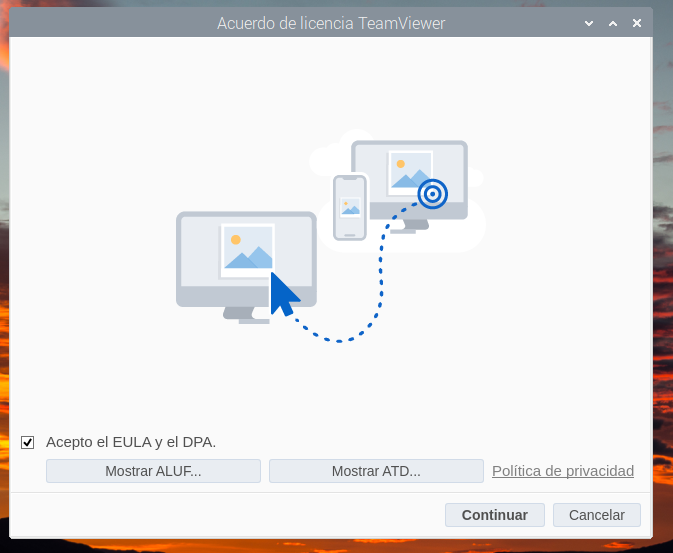
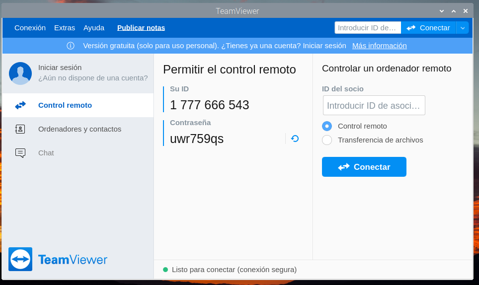
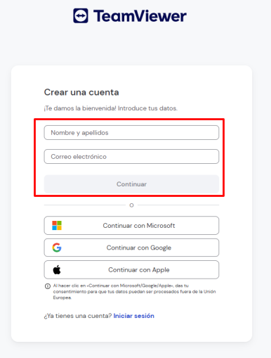
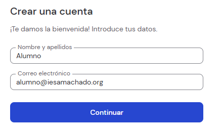
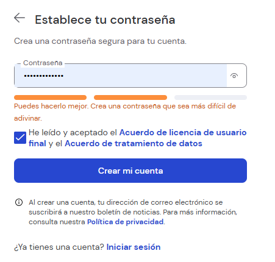
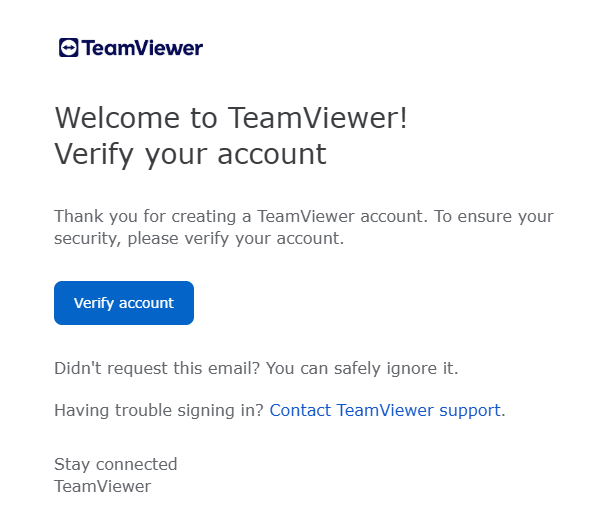
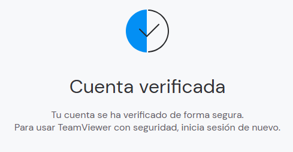
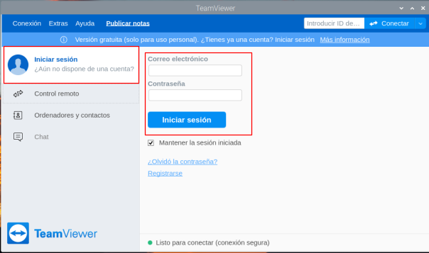
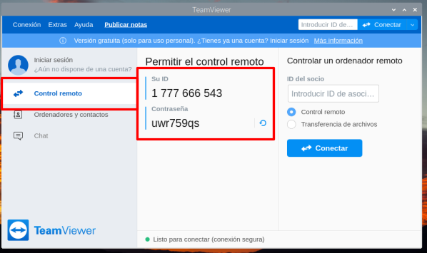
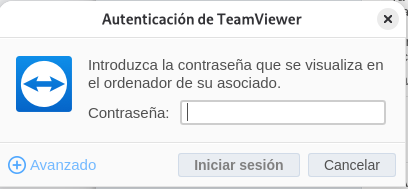

# Práctica: asistencia remota con TeamViewer en Windows

## Objetivo

Comprender cómo funciona la asistencia remota: conectar dos ordenadores, ver el escritorio de otra persona y manejar su ratón y teclado con su permiso.

## Organización y requisitos

La práctica se realiza por parejas. Necesitáis dos ordenadores con Windows, conexión a Internet y TeamViewer instalado. Si no está instalado, pedid instrucciones al profesor antes de descargar o instalar programas.

Decidid quién desempeña cada papel:

- **Usuario (equipo controlado):** permite que su compañero se conecte para recibir ayuda.
- **Técnico (equipo controlador):** se conecta al ordenador del Usuario y realiza la intervención.

La entrega es una por pareja. Si hay tiempo, podéis intercambiar los papeles después de completar la primera ronda.

> **Uso seguro:** conectad únicamente con la persona asignada y con su permiso explícito. Compartid el ID y la contraseña temporal solo con vuestro compañero y no los publiquéis ni los enviéis a otras personas. El Usuario puede detener la conexión en cualquier momento.

## Paso 1. Abrir TeamViewer

1. Tanto el Usuario como el Técnico deben abrir TeamViewer en su ordenador.
2. Si es la primera vez que se inicia, leed y aceptad la licencia siguiendo las indicaciones del profesor.

3. Esperad a que la aplicación indique que está lista para conectarse. El aspecto y los nombres de las opciones pueden variar según la versión.

## Paso 2. Iniciar sesión, si es necesario

Para una conexión puntual con ID y contraseña temporal puede no ser necesario crear una cuenta. Si la versión instalada pide iniciar sesión o el profesor lo indica:

1. Usad únicamente la cuenta del instituto, la que termina en `@iesamachado.org`. No uséis una cuenta personal ni la opción de iniciar sesión con Google.
---

---

---

---

---

---
2. Volved a TeamViewer e iniciad sesión con esa cuenta.

No compartáis contraseñas de cuentas. La contraseña temporal de la conexión es distinta y solo se comunica al compañero asignado.

## Paso 3. Obtener los datos de conexión (Usuario)

1. En TeamViewer, busca el apartado de asistencia o control remoto.
2. Localiza el **ID de TeamViewer** de este dispositivo y la **contraseña temporal** para permitir la conexión.

3. Comunica esos datos al Técnico. No cierres TeamViewer.

## Paso 4. Conectarse (Técnico)

1. En TeamViewer, busca el campo **ID del socio** o la opción equivalente para conectarse a un equipo.

2. Introduce el ID que te ha dado el Usuario y selecciona **Control remoto**, si aparece esa opción.
3. Pulsa **Conectar** e introduce la contraseña temporal del Usuario cuando se solicite.

4. Comprueba con el Usuario que ya ves su escritorio y fíjate que puedes controlar su ordenador.

## Paso 5. Realizar la intervención

Sin tocar el ordenador del compañero, el Técnico realizará estas acciones desde su propio ordenador:

1. Minimiza las ventanas abiertas en el equipo remoto para mostrar el escritorio.
2. Haz clic con el botón derecho en un espacio vacío del escritorio remoto y crea una carpeta llamada `REVISADO_POR_TU_NOMBRE` (sustituye `TU_NOMBRE` por tu nombre).
3. Abre esa carpeta. Con el Bloc de notas, crea un archivo llamado `exito.txt` y guárdalo dentro de la carpeta.
4. Comprueba con el Usuario que ve la carpeta y el archivo creados.

El Usuario observará la intervención en su pantalla. No debe usar el ratón ni el teclado durante la demostración, salvo para pedir que se detenga la conexión.

## Paso 6. Captura y cierre

El Técnico hará una captura de pantalla completa de su propio monitor. Debe verse:

- Su escritorio de Windows, incluida la barra de tareas.
- La ventana de TeamViewer con el escritorio remoto del Usuario.
- La carpeta `REVISADO_POR_TU_NOMBRE` y el archivo `exito.txt` dentro de ella.

Guarda la captura y súbela a la tarea correspondiente del aula virtual. En el comentario, indica quién fue el **Técnico** y quién el **Usuario**.

Al terminar, cerrad la sesión remota desde TeamViewer y comprobad con el Usuario que la conexión se ha desconectado. No dejéis el acceso abierto.
