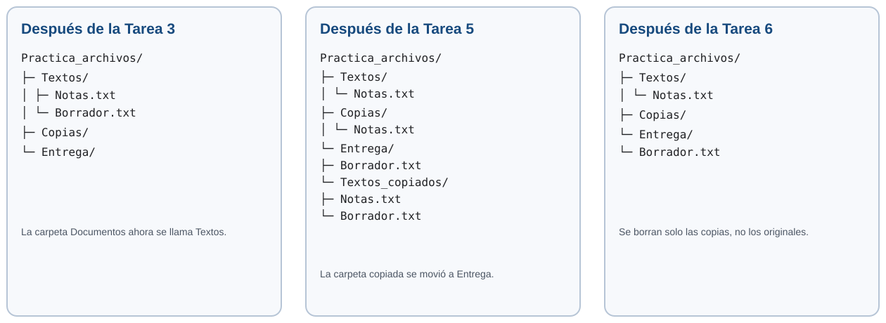

# Directorios y archivos

En esta práctica aprenderás a organizar carpetas y archivos en Ubuntu con **Archivos** (el gestor de archivos). Empieza en el **Escritorio** de tu máquina virtual: allí crearás la carpeta de la práctica y, dentro de ella, el resto de directorios y archivos. Después de cada tarea, haz una captura que muestre el resultado en Archivos y guárdala con el nombre indicado: `Tarea X.jpg`.

Si no aparecen iconos en el Escritorio, abre **Archivos** y selecciona **Escritorio** en la barra lateral. Trabajarás en esa ubicación igualmente.

## Tarea 1. Crear directorios

1. Empieza en el **Escritorio**. Si estás en Archivos, abre la ubicación **Escritorio**.
2. Haz clic con el botón derecho en un espacio vacío y selecciona **Nueva carpeta**. También puedes pulsar **Ctrl + Mayús + N**.
3. Crea una carpeta llamada `Practica_archivos`.
4. Entra en ella y crea tres carpetas: `Documentos`, `Copias` y `Entrega`.
5. Haz una captura donde se vean las tres carpetas dentro de `Practica_archivos`. Guárdala como `Tarea 1.jpg`.

## Tarea 2. Crear ficheros

1. En Archivos, entra en `Escritorio/Practica_archivos/Documentos`.
2. Abre **Editor de texto**, escribe una frase breve y guarda el archivo en esa carpeta con el nombre `Notas.txt`.
3. Repite el proceso para crear `Ideas.txt` con otra frase breve.
4. Comprueba que los nombres incluyen la extensión `.txt` y que ambos archivos están en `Documentos`.
5. Haz una captura donde se vean los dos archivos dentro de la carpeta `Documentos`. Guárdala como `Tarea 2.jpg`.

## Tarea 3. Cambiar el nombre a directorios y ficheros

1. Dentro de `Escritorio/Practica_archivos/Documentos`, cambia el nombre de `Ideas.txt` a `Borrador.txt`. Haz clic con el botón derecho y selecciona **Cambiar nombre**, o selecciona el elemento y pulsa **F2**.
2. Vuelve a `Practica_archivos` y cambia el nombre de la carpeta `Documentos` a `Textos`.
3. Comprueba que dentro de `Textos` están `Notas.txt` y `Borrador.txt`.
4. Haz una captura donde se vea la carpeta `Textos` y los dos archivos. Guárdala como `Tarea 3.jpg`.

## Tarea 4. Copiar directorios y ficheros

1. Entra en `Escritorio/Practica_archivos/Textos`.
2. Copia `Notas.txt` y pégalo en `Escritorio/Practica_archivos/Copias`. Para copiar, selecciónalo y pulsa **Ctrl + C**; para pegar, entra en la carpeta de destino y pulsa **Ctrl + V**. También puedes usar las opciones **Copiar** y **Pegar** del menú contextual.
3. Vuelve a `Practica_archivos` y copia la carpeta `Textos`. Pégala dentro de `Copias`.
4. En `Copias`, cambia el nombre de la carpeta copiada a `Textos_copiados`.
5. Haz una captura donde se vean `Notas.txt` y `Textos_copiados` dentro de `Copias`. Guárdala como `Tarea 4.jpg`.

## Tarea 5. Mover directorios y ficheros

1. Entra en `Escritorio/Practica_archivos/Textos` y mueve `Borrador.txt` a `Escritorio/Practica_archivos/Entrega`. Para mover, pulsa **Ctrl + X** y después, en la carpeta de destino, **Ctrl + V**. También puedes usar las opciones **Cortar** y **Pegar** del menú contextual.
2. Vuelve a `Escritorio/Practica_archivos/Copias` y mueve la carpeta `Textos_copiados` a `Escritorio/Practica_archivos/Entrega`.
3. Comprueba que `Entrega` contiene `Borrador.txt` y la carpeta `Textos_copiados`, y que `Textos` conserva `Notas.txt`.
4. Haz una captura donde se vean los resultados del movimiento. Guárdala como `Tarea 5.jpg`.

## Tarea 6. Borrar directorios y ficheros

1. Entra en `Escritorio/Practica_archivos/Copias` y mueve `Notas.txt` a la papelera. Puedes hacer clic con el botón derecho y seleccionar **Mover a la papelera**, o seleccionar el archivo y pulsar **Supr**.
2. Entra en `Escritorio/Practica_archivos/Entrega` y mueve la carpeta `Textos_copiados` a la papelera con su contenido.
3. No vacíes la papelera.
4. Comprueba que `Textos` conserva el archivo original `Notas.txt` y que `Entrega` conserva `Borrador.txt`.
5. Haz una captura donde se vea el resultado final. Guárdala como `Tarea 6.jpg`.

### Entrega

Entrega las seis capturas, desde `Tarea 1.jpg` hasta `Tarea 6.jpg`. Asegúrate de que en cada una se vea Archivos con la carpeta y los elementos necesarios para comprobar la tarea.
